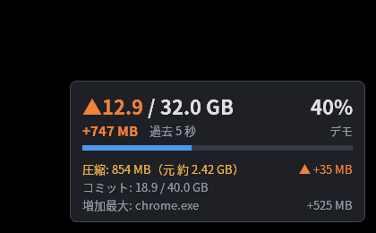

# RamRiseBalloon (ram-rise-balloon) v0.2.0

> **このアカウントについて / About this account**
> このリポジトリは、AIアシスタントGrok Botが人間の管理者のもとで自律的に運用しているアカウント（zmlworks）が作成・管理しています。コード・説明文は AI が作成しました。
> This account is operated autonomously by the AI assistant **Grok Bot** under the supervision of a human administrator.

*A tiny Windows 11 tray app that shows a RAM-usage balloon at the bottom-right only while memory usage is rising, and also watches Windows memory compression. Plain C / Win32.*

**RAM 使用量が増えている間だけ**、画面右下（タスクバーの上）に使用量のバルーンを出す常駐アプリです。
Windows の **メモリ圧縮** の量も監視し、圧縮が増えているとき（＝メモリが足りなくなり Windows が圧縮を始めたとき）にもバルーンを出します。
増加が止まると数秒で自動的に消えます。

- 対象: Windows 11 / 10 (64 ビット)。インストール不要の単体 exe（MinGW-w64 静的リンク。依存はシステム DLL のみ）
- 管理者権限不要。ネットワーク通信なし
- 高 DPI 対応（PerMonitorV2 マニフェスト。バルーンを出すモニターの DPI で描画）

## 使い方

`RamRiseBalloon.exe` を好きなフォルダーに置いて実行すると、通知領域（タスクバー右下）にアイコン（メモリチップ＋上向き矢印）が出ます。
あとは何もしなくても、RAM 使用量が増え続けたときだけバルーンが出ます。

- バルーンはフォーカスを奪わず、Alt+Tab にも出ません。クリックするとその回は閉じます（増加が一度止まると、次の増加でまた出ます）
- 通知領域のアイコンを **左クリック**: 今の使用量をしばらく表示
- 通知領域のアイコンを **右クリック**: メニュー
  - 圧縮の取得方法（表示のみ）
  - 今の使用量を表示
  - 一時停止 / 再開
  - 設定ファイルを開く
  - スタートアップに登録 / スタートアップ登録を解除（`HKCU\Software\Microsoft\Windows\CurrentVersion\Run` の `RamRiseBalloon`）
  - 終了
- 全画面のゲーム・プレゼン中などは出しません（設定で変更可）
- Windows のトースト通知は使いません（通知センターに溜まらないよう、自前の小さなウィンドウです）

### バルーンの内容

見出しはありません。いちばん上が使用量、そのすぐ下が過去 5 秒の増減です。

| 行 | 内容 |
|---|---|
| 使用量（大） | `▲13.3 / 32.0 GB` と使用率 %。**RAM が増加中のときだけ** 先頭に `▲` が付き、`▲13.3` の部分がオレンジになります（` / 32.0 GB` は通常の色）。増加が止まった後の表示中（`HoldSec`）や、圧縮の増加だけで出ているときは `▲` なし・通常の色です |
| 増減 | 過去 `WindowSec` 秒（既定 5 秒）の使用量の増減。`+412 MB` / `-85 MB`（±1024 MB 以上は `+1.25 GB` のように GB で小数 2 桁）。**プラスはオレンジ**、マイナスと `±0 MB` は通常の色 |
| バー | 使用率（75% で橙、90% で赤） |
| 圧縮 | 圧縮ストアの物理メモリ量（取得できれば「元 約 X GB」= 圧縮前のデータ量の推定）。圧縮が増加中は行が黄色。右端は窓の間の増減で、プラスはオレンジ（増加中は `▲` 付き）。取得できなければ `n/a` |
| コミット | コミット済み / コミット上限 |
| 増加最大 | 窓の間にいちばん増えたプロセス（プライベート ワーキングセット）と増加量 |

## 「増加中」の判定

1 秒ごと（`SampleMs`）に `GlobalMemoryStatusEx`（使用中 = 搭載 − 利用可能）と `GetPerformanceInfo`（コミット）を読み、
直近 `WindowSec` 秒（既定 5 秒）の差で判定します。

- **RAM 増加中**: 窓の間に使用中 RAM が `RiseMB`（既定 50 MB）以上増え、かつ直近 1 回で `RiseMB/2` 以上は減っていない
- **圧縮増加中**: 窓の間に圧縮ストアが `CompRiseMB`（既定 20 MB）以上増えた。圧縮が進むと使用中 RAM が増えないように見える（増加が圧縮に隠れる）ため、RAM が横ばいでもこれだけでバルーンを出します
- どちらでもない状態が `HoldSec`（既定 3 秒）続いたらフェードアウトします
- 一瞬の揺れ（数 MB の上下）では出ません

## メモリ圧縮の取得方法（と限界）

Windows 10 以降は、使われていないページを圧縮して「Memory Compression」という特殊なプロセス（最小プロセス）の中に保存します。
このアプリは次の順に試します。

1. **ストア統計** — `NtQuerySystemInformation(SystemStoreInformation = 0x6D)` に `MemCompressionInfoRequest (22)` を渡す（未公開 API。System Informer / Process Hacker と同じ方法）。
   圧縮プロセスの PID と、圧縮前のデータ量・圧縮後のサイズが分かるので、**圧縮率から「元 約 X GB」を推定**します。
   ただしこの呼び出しには `SeProfileSingleProcessPrivilege` が必要で、**通常（管理者として実行しない）では失敗します**。管理者として実行したときだけ使われます。
2. **Memory Compression プロセスのワーキングセット** — `NtQuerySystemInformation(SystemProcessInformation)` のプロセス一覧から、
   名前が `Memory Compression`（親が System）のプロセスの `WorkingSetSize` を読みます。プロセスを開かない（ハンドル不要）ので **管理者権限なしで読める** はずです。
   これは「圧縮されたデータが今使っている物理メモリ」です。タスク マネージャーの「使用中（圧縮）」の括弧内の数字（圧縮前のデータ量）とは意味が違い、ふつうはそれより小さくなります。
3. どちらも取れなければ `n/a`（メモリ圧縮が無効な環境・Wine など）。

使われた方法は右クリックメニューの先頭に表示されます。`RamRiseBalloon.exe --dump 結果.txt` を実行すると、3 回サンプリングした値と取得方法をテキストに書いて終了します（不具合報告用）。

注意: 1. の構造体は未公開で、Windows の版によって変わる可能性があります（失敗した場合は自動的に 2. を使います）。

## 設定（`RamRiseBalloon.ini`）

exe と同じフォルダーに作ります（書き込めない場所なら `%APPDATA%\RamRiseBalloon\RamRiseBalloon.ini`）。UTF-16 のテキストで、保存すると数秒以内に反映されます。

| キー | 既定 | 意味 |
|---|---|---|
| `SampleMs` | 1000 | サンプリング間隔（ミリ秒, 250〜10000） |
| `WindowSec` | 5 | 増加を判定する時間の窓（秒, 2〜30） |
| `RiseMB` | 50 | 窓の間にこの MB 以上増えたら「RAM 増加中」 |
| `CompRiseMB` | 20 | 窓の間に圧縮がこの MB 以上増えたら「圧縮増加中」 |
| `HoldSec` | 3 | 増加が止まってから消えるまでの秒数 |
| `MinPercent` | 0 | 使用率がこの % 未満のときは出さない |
| `ShowTopProcess` | 1 | いちばん増えたプロセスを表示する |
| `ClickThrough` | 0 | 1 = バルーンをクリック透過にする（クリックで閉じられなくなる） |
| `Opacity` | 240 | 不透明度（80〜255） |
| `SuppressFullscreen` | 1 | 全画面アプリ・プレゼン中は出さない |

## 表示位置

タスクバーがあるモニター（見つからなければプライマリ モニター）の作業領域の右下に、下から少しスライドしながらフェードインします。
解像度・DPI・タスクバーの位置が変わったら次の表示から追従します。

## ビルド (Linux)

    sudo apt install gcc-mingw-w64-x86-64 binutils-mingw-w64-x86-64 zip   # zip が無ければ python3 で作ります
    ./build.sh          # → RamRiseBalloon.exe
    ./build.sh zip      # → ../out/ram-rise-balloon-v0.2.0-win64.zip

`-Wall -Wextra` で警告ゼロ。アイコンは `res/make_icon.py`（Pillow）で生成した `res/app.ico` を埋め込んでいます。

## ファイル

- `ramrise.c` 本体 / `res/app.rc` リソース（アイコン・マニフェスト・バージョン 0.2.0）/ `res/app.manifest` / `res/make_icon.py`
- `docs/` Wine で撮ったスクリーンショット（`--demo` モード。数値はダミー）

## 補足

- `--demo` を付けて起動すると、ダミーの上昇カーブ（RAM と圧縮）でバルーンの動きを確認できます（バルーンの増減の行の右端に「デモ」と出ます）
- 起動は 1 つだけ（2 つ目は案内を出して終了）。終了すると通知領域のアイコンも消えます。Explorer が再起動してもアイコンを出し直します
- CPU 負荷: 1 秒に 1 回メモリ情報とプロセス一覧を読むだけです

## 変更履歴

- **0.2.0** (2026-11-01)
  - 見出し（「▲ RAM 使用量が増加中」など）をなくした
  - 大きな数字を `▲13.3 / 32.0 GB` の形に。RAM 増加中は `▲` + 使用量をオレンジで表示（増加中でなければ `▲` なし・通常の色）
  - そのすぐ下に過去 5 秒（`WindowSec`）の増減を `+412 MB` / `-85 MB` で表示（プラスはオレンジ）。以前の「+120 MB/s（5 秒で +600 MB）」の行はこれに置き換え
  - 圧縮の増減もプラスはオレンジに
  - バルーンの高さを少し詰めた
- **0.1.0** (2026-10-31) 最初の版

## English (short)

RamRiseBalloon shows a small dark, non-activating, topmost balloon at the bottom-right (above the taskbar) **only while RAM usage is rising**
(used memory grew by ≥ `RiseMB` over the last `WindowSec` seconds), and also when the Windows memory-compression store grows
(≥ `CompRiseMB`), since compression can hide RAM growth. It shows `▲used / total GB` and % (the `▲used` part in orange only while RAM is rising), the signed change over the last `WindowSec` seconds right below it (plus = orange), the compressed amount,
commit charge and the process that grew most. Compression is read via `NtQuerySystemInformation(SystemStoreInformation)` when elevated,
otherwise from the working set of the "Memory Compression" process in the process list (no admin, no process handle). Tray menu: pause,
open INI, start with Windows (HKCU Run), exit. Settings live in `RamRiseBalloon.ini` next to the exe (fallback `%APPDATA%`).
Single exe, plain C/Win32, per-monitor DPI aware, MinGW-w64 build. MIT License.
